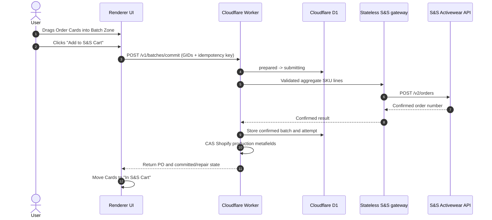

# Blanks Batching & Purchasing Workflow

## Use This When
- You are modifying the blank-apparel batching zone, SKU consolidation, or S&S ordering logic.
- You are debugging batch submit failures or price aggregation errors.

## Skip This When
- You are working on general Kanban board card layout → read [Order ingestion and Kanban](order-ingestion-kanban.md).
- You are editing external API authorization parameters → read [External APIs](../architecture/external-apis.md).

## Section Map
- [Blanks Batching Sequence](#blanks-batching-sequence)
- [SKU Aggregation Algorithm](#sku-aggregation-algorithm)
- [Tultex 202 Shelf Claims](#tultex-202-shelf-claims)
- [Batch Submission & State Update](#batch-submission--state-update)
- [Safe Local Feedback Simulation](#safe-local-feedback-simulation)
- [Receiving Manifest and Batch Correction](#receiving-manifest-and-batch-correction)
- [Common Failure Modes & Recovery](#common-failure-modes--recovery)

---

## Blanks Batching Sequence

---

## SKU Aggregation Algorithm

When orders are dragged into the batch zone:

1. Resolve selected GIDs from active D1 projections and validate their production stages.
2. Read complete Shopify-derived line items from the projection; exclude known print-service lines and the exact artwork-service SKU `PM-ART-BG-REMOVE`. Its customer charge remains unchanged. Other `PM-*` SKUs are not excluded by prefix.
3. Filter items containing valid supplier `sku` strings.
4. Group by `sku` and aggregate total required quantities:
   $$\text{TotalQty}(\text{SKU}_k) = \sum_{i \in \text{SelectedOrders}} \text{ItemQty}_i(\text{SKU}_k)$$
5. Hash the canonical sorted line set and capture every selected production revision.

---

## Tultex 202 Shelf Claims

For exact Tultex 202 Shopify variants, staff record the **physical on-shelf** count in Order Manager's Inventory tab and reserve a whole or partial order-line quantity from the Production tab. Reservations reduce free units without changing the physical count. Staff then mark blanks pulled when they physically leave the shelf, reducing on-shelf stock. A physical return restores on-shelf stock but keeps the reservation until an explicit release. The authenticated D1 ledger audits each step with an actor and idempotency key. Uncounted variants cannot be reserved. Cancellation never returns stock automatically. Shopify inventory, checkout availability, and supplier inventory observations are unaffected.

The Worker subtracts active shelf claims from both the S&S aggregate request and its per-order line sources. The browser subtracts the same quantities from a new receiving manifest. Claims are locked once an order enters a prepared, submitting, confirmed, or uncertain supplier batch. A changed or missing Shopify line blocks submission for review. An order fully covered by shelf claims is omitted from an S&S batch; staff verify the blanks and use the existing Order Detail readiness control to mark them ready without a PO.

The `SHELF_ALLOCATION_ENABLED` Worker flag gates this first release to Tultex 202. Physical counts begin uncounted and must come from a shelf count, never Shopify HQ balances. The Inventory tab shows on-shelf, reserved, and free quantities and a queue of reservations still waiting to be pulled.

The installed Order Manager app must have Shopify `read_products` as well as order access. Shopify can return order-line SKUs while returning `null` for `LineItem.variant` without that scope. The Worker requires the variant and its exact product ID before accepting a count or reservation; when the scope is missing, Order Detail shows `SHELF_PRODUCT_ACCESS_REQUIRED`.

---

## Batch Submission & State Update

1. The Worker inserts an idempotent D1 batch and allows only one transition to `submitting`.
2. Before aggregation, the Worker retains a private SKU-to-source-order map so supplier feedback can identify the affected PrintMO order without sending customer data to S&S.
3. The Render gateway validates aggregated lines, adds server-held credentials/payment/shipping configuration, and posts to S&S **Orders**, without reading Redis. `SS_TEST_ORDER` is passed through unchanged; S&S documents test orders as created and cancelled, not a shopping-cart API operation. Optional per-SKU price lookups remain skipped in test mode. Responses can contain both created `Orders` and native `LineErrors`; order-number-only and summary-only success remain supported.
4. The Worker normalizes every attempt as `confirmed`, `partial`, `rejected`, or `unknown`, stores the redacted report in `batches.response_json` and `supplier_attempts`, and exposes the latest report to the authenticated board.
5. The supplier response is stored before production metadata advances. Customer orders with fully covered supplier requirements use the existing `blanks_cart` workflow stage; that stage name does not establish an automated S&S cart operation. Service charges do not count as supplier garments. Missing or unmatched line details are separate from order-placement success, and short shared SKUs are not allocated between customer orders by guess.
6. Recognized native validation/line errors retain their deterministic rejection evidence. HTTP status alone is insufficient: authentication errors, missing confirmation and contradictory evidence must not be converted into a known rejection. The board shows the human-readable product and variant, rejected SKU, requested quantity, affected order, and supplier reason when returned.
7. If the supplier confirms but metadata is incomplete, the response lists repair-required GIDs and nightly integrity reconciliation repairs them. The supplier order is never resent.
8. The gateway marks whether an S&S order POST was attempted. An error known to occur before that POST is stored as failed and shown as safe to retry after the issue clears. A timeout, gateway `5xx`, or success-shaped response after the POST (or without a trustworthy attempt marker) is stored as `unknown`, displayed with its batch reference, and must not be blindly retried.

Error reports retain native `upstreamHttpStatus` and bounded `supplierMessage`
separately from the gateway transport status, plus original `attemptStartedAt`.
`orderSubmissionAttempted` is true, false, or null when evidence is absent;
absence never proves that no order POST occurred. Blocked selections show their
own quantities and the earlier attempt's time/error.

An explicitly owner-authorized retry resolution is an append-only
`supplier_attempts` row of type `owner_retry_resolution`, outcome
`owner_authorized_retry`. Its original line hash, updated timestamp and exact
response snapshot must still match the reviewed failed/unknown batch before it
can stop blocking a deliberately new intent. The original batch and commit audit
remain unchanged. This does not establish supplier placement, replay an old
intent, release in-flight claims, or waive other unknown attempts. There is no
new public override endpoint or supplier retry automation.

Deployed retry correction: an authenticated native JSON
HTTP 503 with code `503` and exactly "You are being throttled. Please wait 1
minute before your next request." is classified as `rate_limited` only without
contradictory order or line evidence. This is the supplier's explicit refusal,
not a guarantee that no order could exist. The report retains
`orderSubmissionAttempted: true`, original time and native message; it is never
labelled preflight/not sent. A deliberate new intent is allowed after the saved
cooldown (at least 60 seconds from the response). There is no automatic POST.
Same-key replay, concurrent claims and genuinely ambiguous outcomes stay guarded.
Generic 503, missing JSON/code, transport failure or contradictory evidence do
not qualify. Existing historical records are not automatically reclassified.

Native supplier HTTP error statuses are preserved, including 503; a gateway
failure keeps its own status. Commit JSON is serialized once. Gateway logs record
an opaque response ID, batch reference, status, MIME, UTF-8 byte count and
`serialized` / `finished` / `closed_early` events. The Worker retains the ID from
`X-Order-Manager-Response-Id`, body format/length and supplier-field presence
booleans; an interrupted body read records `failurePhase: body_read` and unknown
length. Raw HTML, customer bodies and credentials are not retained. A Node
`finished` event does not prove receipt by the Worker. The complete local HTTP
fixture verifies the actual gateway handler, Worker parser, persistence and UI;
it does not establish which hosted hop replaced the historical response.

### Submission regression boundaries

- Feedback/UI changes must not change purchase eligibility, intent lifetime,
  supplier calls, payloads or flags without an explicit reviewed contract change.
- `SS_TEST_ORDER=1` still reaches Orders; never infer a remote cart capability.
- Placement, item attribution and internal board movement are separate facts.
  Preserve official references/native errors even when SKU detail is unresolved.
- Keep same-intent replay and atomic concurrent claims. Do not restore lifetime
  holds based on completed historical placements or identifier-only warnings.
- A blocked wrapper with zero commits did not dispatch. New response logging
  cannot execute for that action, and missing metadata in its older report is not
  evidence that the newly deployed logger failed. Diagnose before adding controls.

See [the troubleshooting procedure](../runbooks/troubleshooting.md#supplier-503-followed-by-an-immediate-blocked-selection)
and [the test map](../reference/test-map.md) before changing recovery behavior.

The result leads with the official S&S order reference(s) and native supplier
errors. Order placement and line attribution are separate facts: missing quantity
is not zero; explicit zero stays zero; a mismatched supplier identifier does not
erase the returned order reference or other line evidence. `sku` and numeric
`skuID` are distinct fields, selected by explicit name priority rather than JSON
property order. An ID-only historical response is not guessed into a SKU.

For Print-MO's normal cart workaround, staff review the returned order on S&S,
choose **Cancel Order**, then **Yes** to add items back to cart when that step is
outstanding. The app does not perform cancellation or website-cart read/write.
The report never asserts that this manual step has already occurred. Genuine
ambiguous POST outcomes still require review before any repeat submission.

The deployed audited correction retains original same-attempt idempotency and uses
existing batch evidence to protect actual overlapping unresolved demand. A prior
fully confirmed customer order is not a lifetime lock on future demand. The
`0015` hold/audit tables and their existing records are preserved as history; they
are no longer the normal submission eligibility gate. The bespoke cart-review
and cart-reconcile endpoints are retired with `410`, without deleting history.

Blocked, saved and replayed actions explicitly identify that no new supplier
request was sent. The deployed restoration leads with the
current selection and keeps old evidence in a separate collapsed disclosure.
Known order references with attribution-only warnings or completed native partial
results are not permanent ordering bans. In-flight requests and genuinely
ambiguous POST outcomes remain protected, including ambiguous HTTP failures with
references. A known preflight failure is safe to retry. The client retains the same
intent key while a request is running or ambiguous; a deliberately new order after
a completed result uses a new key. The added retry-review override is retired with
`410` and its historical audit remains intact. No original supplier result is
rewritten or silently resolved by this eligibility restoration.

Explicit selected board corrections reuse the existing reviewed **Move to In S&S
Cart** workflow after the operator's cancel/add-back step. This changes production
stage without another supplier request or rewriting the original supplier report.
It does not create a receiving manifest or mark garments received. PDF export and
automatic residual supplier retry remain deferred. Worker and Pages are deployed;
the gateway mapper correction is deployed too. Unmatched identifiers remain
explicit review cases without guessed aliases; see the current release boundary.

The stateless gateway is deployed from the sibling `shopify-ss-integration` source boundary. Gateway commit `d3a0d5a` introduced an operator-safe `Orders`/`LineErrors` shape plus normalized accepted lines from `/order-manager/v1/supplier/ss/commit`; it strips shipping, payment, pricing internals, and unknown supplier fields. Structured S&S `400`, `404`, and `422` responses remain deterministic rejections. A failure before the order POST is safe to retry only when the gateway explicitly attests that the POST was not attempted; authentication, throttling, server, and transport failures during or after the POST remain uncertain. Changing S&S `rejectLineErrors` behavior remains a separate gateway release decision and must first be exercised with `SS_TEST_ORDER=1`.

Confirmed batches leave `readiness.blanksOrdered` false so newly submitted cards appear in **In S&S Cart**. **Mark In Cart Ordered** asks for the S&S order number, records a searchable receiving manifest, then advances the current cart cards to `blanks_ordered` and opens the Ordered view. Use the receiving workspace to link subsets when the cart spans multiple S&S orders. The Worker enforces the stage/readiness pairing for both Blanks substages so reloads cannot classify an ordered card as in-cart. Reconciliation preserves that later stage and readiness instead of moving cards backward.

Legacy Redis mode continues using its existing process-batch route until final cutover; candidate mode never calls it.

## Garment COGs Estimates

The Shopify board hydrates catalog-derived garment costs after rendering through authenticated
`POST /order-manager/v1/garment-costs` with up to 50 Shopify GIDs or Etsy order keys.
Native Shopify lines use their current variant identity; Etsy lines require one exact
Shopify catalog match for the resolved supplier SKU. Customer sale prices are never used.
Native order reads include current catalog `inventoryItem.unitCost` alongside the
garment variants, avoiding one extra request per distinct variant. Up to four
orders load together under a shared limit of four upstream operations; a slow
first order does not prevent the others from starting. Etsy exact-SKU and fallback
variant lookups retain their five-minute cache. Requests have a 20-second budget
and fail independently of board rendering and ordering.

**In S&S Cart** shows the estimated supplier purchase total and expandable manual/missing-cost
exclusions. **Items & financials** separates total garment cost, shelf cost, and the amount
to buy from S&S, with a per-garment breakdown. Prints, manual items, shipping, and taxes
are excluded. Only USD costs are summed; null, changed/ambiguous SKUs, inaccessible variants,
and different currencies are explicit exclusions. Zero-dollar catalog costs are valid.
The persistent detail header shows overall garment cost across tabs, including shelf garments;
it does not substitute the S&S purchasing amount. Its action opens the supporting disclosure
after commerce totals. Loading, unavailable, partial-known totals, saved provenance, and changed
capture quantities remain explicit.

Creating a receiving manifest captures a server-derived `garmentCostSnapshot` on each
identified order in the private R2 manifest. Receiving and membership transfers preserve
the capture. Later line changes are flagged as outside the saved estimate; older records
without captures use a clearly labeled current catalog estimate. Missing lookup data is
saved as unavailable and never prevents marking ordered. These amounts are estimates,
not S&S checkout/invoice totals, and no supplier price sync or retail-price mutation occurs.

Focused checks: `node --test order-manager-proxy/garment-costs.test.mjs`; Phase 2 covers
endpoint authorization, server-derived amounts, and receiving/transfer preservation.

The bounded parallel/inline-cost correction was deployed on 2026-10-11 as Worker
version `60de7432-921b-4e7c-9aa8-6065eab407dc`. All 12 cost tests, the proxy
test/build, Phase 1/2 and documentation checks passed. An authenticated dashboard
reload resolved the three current cart estimates; intermittent upstream latency
is not represented as a measured performance guarantee.

## Safe Local Feedback Simulation

Run `npm run repo -- simulate ss-feedback -- --scenario random` to pass three synthetic shirts through the real Worker response normalizer and print the product, variant, SKU, affected PrintMO order, quantities, and supplier reason. The command is fully local: it makes no S&S, Shopify, Worker, or database request. Use `--scenario partial`, `out-of-stock`, `invalid-sku`, `accepted`, or `timeout` for a specific outcome, `--seed <integer>` to repeat a random fixture, and `--json` for the normalized report payload.

## Receiving Manifest and Batch Correction

After **Mark In Cart Ordered**, the browser records an authenticated receiving manifest through `/order-manager/blanks-batches`. This compatibility manifest currently lives in the private `PREVIEWS` R2 binding; it is separate from the durable supplier-order state machine in D1. Each new manifest stores both the immutable Shopify order GID and the display name so legacy name-only manifests remain readable while new membership checks use stable identity. Manifests also carry S&S order number(s), optional Print-MO PO, and optional tracking number. Linked numeric S&S order numbers receive automatic read-only order and carrier updates through the supplier gateway; the receiving workspace shows the observed status and check time.

The receiving UI has two levels:

1. Order detail defaults to compact per-variant receipt statuses. **Receive garments** reveals the existing garment sub-rows with `−`, quantity, `+`, and **Save**, plus the order's **Receive Batch/Batches** entry point. **Hide receiving** preserves typed input without committing it. Save/Enter commits typed quantities; steppers retain immediate saves. Controls update the matching batch manifest line without opening another modal over Order Detail; newly complete orders surface a review/move notification. This is presentation cleanup, not the separately deferred delivery-first receiving redesign.
2. **Receive Batches** is the shipment lookup and aggregate manifest workspace. Staff can link an outside S&S purchase to selected unbatched customer orders without placing another supplier order, edit shipment references, check in all remaining garments in one action when the delivery contains them all, adjust individual quantities for split deliveries with automatic save, and correct membership with **Add Orders**. Navigation waits for an in-flight receiving save instead of asking staff to discard a draft.

Only physically checked, usable garment quantities are entered as received. A carrier delivery alone never updates received counts. Shared-SKU quantities are proposed oldest-first, but affected customer orders remain incomplete until staff confirms the per-order allocation. After a check-in or allocation confirmation newly completes orders, the workspace lists those orders and offers **Review** or **Move all newly complete**. The move action re-reads each order, excludes unpaid orders, and moves only the orders completed by that check-in. Ready to Print cards show a prints-pending blocker when `printsStatus` is false; the Worker rejects an increase in printed count until prints are marked ready.

The shipment lookup offers **Needs receiving attention**, composed with the existing reference search. `receiving-review-model.js` derives the same visible reasons used for filtering: garments still to check in, pending allocation confirmation, and supplier delivery exceptions/canceled/not-found states. Counts above the list continue to cover all shipments; the results label names that scope and empty results offer **Clear filters**. Delivery status never establishes physical receipt.

Inside a manifest, **Confirm all N full lines** confirms only saved, unconfirmed shared lines whose usable received quantity covers their entire consistent per-order demand. Edited allocation inputs and short lines remain in individual review. The operator confirms after physical counting/sorting. The browser re-reads the shipment and compares selected quantities/membership before making sequential existing allocation calls. It stops on an unconfirmed response, retains acknowledged successes and untouched input drafts, and requires Refresh before retrying. Receiving/navigation controls are disabled during that operation; it does not automatically move orders. Receiving tasks and the newly complete review live in the inner scroll owner, followed by shipment reference/delivery details, so mobile retains space for the manifest. This slice changes no supplier calls, receiving endpoints, or storage schema.

**Add Orders** always requires an explicit checkbox selection. An unbatched In S&S Cart order is added and advanced to Ordered. An order already in another receiving batch is transferred in one Worker request: the source membership is removed, already-received quantity follows the order up to its expected quantity, the target is recalculated with a suggested allocation, and an emptied accidental batch is removed from the active index. Creating a second active manifest for an already-batched order returns `409 ORDER_ALREADY_BATCHED`.

The one-active-receiving-batch rule is enforced by the Worker, not only by hidden or disabled controls. The current R2 operation uses a bounded multi-object write with best-effort rollback; migrating this compatibility manifest into normalized D1 receiving tables remains the route to database transactions and audit history.

---

## Common Failure Modes & Recovery

| Symptom / Trap | Root Cause | Diagnosis & Recovery |
|---|---|---|
| Batch submit button disabled | Selected orders contain missing or empty SKUs | Inspect order items in detail modal; assign supplier SKU before batching. |
| API Error 400 invalid SKU payload | SKU format mismatch in S&S catalog | Verify SKU string against S&S catalog convention (e.g. `STYLE-COLOR-SIZE`). |
| Duplicate S&S orders placed | Network retry on timeout without idempotent key | Verify S&S dashboard before re-submitting failed batch calls. |
| Print count says the garment total is `0` | `PrintMOProductionState` omitted `sku`, while validation excludes lines without a supplier SKU | Keep `sku` in the production-state query and its regression contract; refresh Shopify after deploying the Worker. |
| Receive Batches appears above Order Detail but cannot be clicked | A dynamically created overlay was omitted from the shared focus/inert dialog stack | Keep `#blanks-receive-overlay` and `#batch-correction-overlay` registered by `accessibility-hardening.js`. |
| A missed order creates a second receiving batch | The order was submitted through create instead of explicit add/transfer | Open the intended batch, choose **Add Orders**, select the missed order, and let the Worker transfer any existing membership. |
