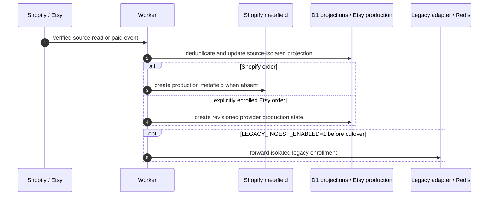
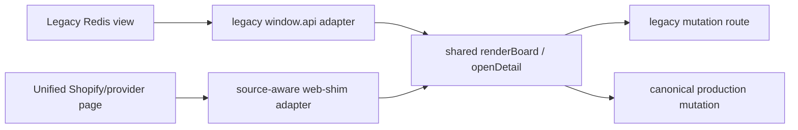

# Order Ingestion and Shared Kanban Workflow

## Use This When

- You are changing order enrollment, shared board rendering, stage transitions, card drag/drop, or detail opening.
- You need to understand how Legacy Redis and Shopify-board data reach the same renderer without sharing mutation authority.

## Skip This When

- You are changing supplier aggregation or submission → read [Blanks batching](blanks-batching.md).
- You are changing Electron transport → read [IPC and storage](../architecture/ipc-and-storage.md).
- You are changing Shopify production ownership or D1/R2 → read [Shopify-primary data plane](../architecture/shopify-primary-data-plane.md).

## Section Map

- [Order Enrollment](#order-enrollment)
- [Shared Board Render and Mutation Flow](#shared-board-render-and-mutation-flow)
- [Stage and View Semantics](#stage-and-view-semantics)
- [Card and Detail Interactions](#card-and-detail-interactions)
- [Manual Target Dates](#manual-target-dates)
- [Common Failure Modes & Recovery](#common-failure-modes--recovery)

## Order Enrollment

Candidate enrollment and legacy fallback ingestion may coexist before cutover, but their reads and mutations remain isolated. Automatic Etsy enrollment remains off during the synthetic/manual pilot.

## Shared Board Render and Mutation Flow

The desktop and embedded clients reuse the board renderer through different adapters:

- Legacy mode maps legacy queue objects into the renderer and persists through authenticated `/legacy/` routes.
- Candidate mode maps bounded Shopify and enrolled-provider DTOs into the renderer and persists through the same versioned production endpoint surface. Shopify writes remain canonical in its app metafield; Etsy pilot writes remain canonical in provider-owned D1 state.
- Cards and detail headers carry an always-visible source text badge. Etsy also uses an orange rail; synthetic fixtures add a separate `TEST` badge, so color is never the only source signal.
- Supplier batching remains Shopify-only. The adapter rejects an S&S submission containing an Etsy order, and Etsy pilot artwork upload remains disabled until a provider-safe asset contract exists.
- Source selection is a view/adapter choice, not a copy or dual-write operation.
- Candidate queue loads are generation-guarded. Within affected columns, unchanged cards retain their DOM and loaded previews; version-only acknowledgments do not recreate cards. Reused cards open the latest DTO by provider and immutable order identity.
- Slow private assets hydrate after commerce/production cards are usable.

The Stage 2 list is an opt-in embedded candidate extension
(`?printmo_list_preview=1`). Board remains the reload default; Legacy remains
Board. Its controller reads `getOrderManagerBoardSnapshot()` and existing
board/accounting events, with a read-only supplier getter from the batch cache.
Browsing does not fetch queue/detail or write production state. Opening a row
resolves its latest immutable identity and uses the existing shared detail path,
including that path's normal on-demand hydration.

The pure `order-board-model.js` shares quantities, printable progress and
Pipeline triage. Search covers order number, customer and bundle only. Additional
filters combine with AND; stage counts reflect search/additional filters before
stage selection. In-memory query, sort and filters survive Board/List, Draft
Orders and detail. Closing detail restores focus/scroll; when the order leaves
results, the nearest surviving row receives focus and the list announces it.

The eight-column desktop table has sticky headings; below 1200px, stacked rows
retain the same facts inside the list's vertical scroller. Counts remain individual
bundle members, material milestones do not imply artwork approval or release,
and supplier delivery does not imply received or allocated garments. Missing
financial/receiving data stays unknown. This preview carries no selection
or inline workflow actions; see the
[staged list-view plan](../future-plans/order-dashboard-list-view-plan.md).

Candidate moves are optimistic and atomic:

1. Derive the complete destination stage.
2. Snapshot local status fields.
3. Repaint immediately.
4. Send one canonical production patch with expected revision and idempotency.
5. On one `VERSION_CONFLICT`, adopt current state and retry at most once when still needed.
6. On terminal failure, restore the snapshot and show a non-blocking error.

Overlapping moves layer the latest local intent over server-confirmed production
state. Older acknowledgments cannot pull a card out of its newer destination;
failure restores the latest confirmed state. Bundle persistence settles every
member before reporting failure, retaining acknowledged member changes. Existing
canonical version checks, serialization and conflict reconciliation remain in use.

Production and Ordered drops skip supplier-accounting lookups because those
destinations cannot require batch-membership correction. Moves back to Pipeline,
Build Order or In S&S Cart retain the accounting lookup and correction choice.
Local visual updates reuse cached accounting; queue refreshes and explicit
receiving/batch operations remain responsible for hydrating supplier records.

Background queue paints defer while dragging, checking a batch or saving a move,
then refresh once the interaction settles. Local moves still paint immediately.
Loading feedback appears only after a short delay, without changing card size or
material-status colors. Desktop drops use one interruptible 180ms translation;
save acknowledgment does not replay an entrance. Reduced motion is immediate.

Accepted desktop drops retain the drag copy and temporary target slot until the
optimistic board paint, including while a required batch lookup/review is pending.
The original card stays visually hidden in that interval. Only the explicit move
paint completes the handoff and runs the layout adjustment; loading/status DOM
mutations cannot trigger it early. Cancellation or a pre-paint error clears the
handoff through the drop completion event. This avoids revealing the origin and
then replaying a second move when accounting finishes.

Resting candidate cards use `will-change: auto`. Landing animations cancel their
finished transform effects so text returns to normal rendering instead of staying
on a retained movement layer; the temporary drag copy keeps its own transform hint.

## Stage and View Semantics

Candidate stages are:

- `received`
- `to_order`
- `blanks_cart`
- `blanks_ordered`
- `print`
- `completed`

`blanks_cart` and `blanks_ordered` are distinct canonical stages. **In S&S Cart** and **Ordered** tabs filter those stages; selecting a tab alone is read-only. A confirmed supplier submission enters `blanks_cart`; an operator later marks it `blanks_ordered`. After confirmation, the client repaints both `to_order` and `blanks_cart` immediately and opens **In S&S Cart**. Adapter-side batch metadata must not preempt the renderer's source/destination-column calculation.

The Shopify board keeps commerce fulfillment separate from PrintMO production state. Ready to Print has two internal views: **To Print** renders canonical `print` orders and **Printed** renders canonical `completed` orders. Completed but unfulfilled work remains in Printed for customer handoff. Exact Shopify `FULFILLED` or an archived order’s `closedAt` removes an order from every active dashboard section without rewriting its production stage. The preserved order appears in the lazy-loaded, view-only **Previous Orders** desktop menu or **History** mobile menu; the list contains no asset summaries, and complete detail/artwork loads only after an order is opened.

Shopify archive, cancellation, and fulfillment are source-driven rather than operator production actions. When an authoritative summary reports `closedAt`, `cancelledAt`, or exact `FULFILLED`, the Worker keeps the D1 projection and production history but marks the projection inactive. Production edits, batch reconciliation, and clearing a PrintMO archive cannot reactivate it while Shopify continues to report any of those conditions. A fulfillment reversal restores the preserved stage when the order is otherwise active; cancelled orders remain outside this first history view.

The production panel’s **Printable pieces** editor saves per-line-item `printEligibility` overrides (Automatic, Include, Exclude). Defaults follow supplier-SKU garment detection; overrides do not affect supplier purchasing or commerce quantities. The Worker validates current line IDs and computes the cap from current quantities, including paginated lines. Selecting eligibility never marks pieces printed. Excluding already-counted pieces requires reducing progress first.

Saving the nonzero printable piece total as `printedCount` from a `print` order sends `printed_count` and `stage: completed` in one versioned production patch. Lowering a completed order below its printable piece total sends `stage: print` in the same patch. The selected Ready to Print tab remains stable; count badges and an accessible status notice communicate the move.

Legacy status values remain compatibility data for the Legacy Redis view only.

## Card and Detail Interactions

- `renderer.js → renderBoard` owns shared card rendering.
- `renderer.js → openDetail` opens the shared detail overlay.
- `renderer.js → splitOrderAssets` normalizes legacy/manual/Designer Studio asset containers.
- Candidate summary cards use bounded board DTOs and never fetch rich detail during initial board load.
- Candidate rich detail is fetched on demand.
- Provider identity uses `_orderKey`/`orderKey`; combined customer/order display names remain presentation text only.
- Candidate source switching preserves the last usable board if the requested source fails.
- The shared detail's current limitations and the reliability-first redesign path are documented in [Order Detail Digital Traveler Redesign](../future-plans/order-detail-digital-traveler-redesign-plan.md). Do not infer complete production eligibility from the current four readiness flags.

### Manual Target Dates

Implementation status: target-date editing and dashboard presentation are deployed.
The compact Rush/date presentation was verified in release `1791818752348`
(Pages `c124dd33`) on 2026-10-12; that presentation update required no Worker change.

The Overview **Target date** section lets an active production-board operator set,
edit, cancel an edit, or clear an internal finish-by day with a native date picker.
The day ends in `America/Chicago`; no time-of-day or customer promise is inferred.
No date is assigned by default. History displays the saved date without editing.

Cards display a compact read-only schedule line beneath the header, ahead of
artwork: neutral `Due Sep 16`, amber `Due today · Sep 15` / `Due tomorrow · Sep 16`,
or red `Overdue · Sep 12`. Completed and history orders keep a neutral Target date.
List uses its existing Due / Age area, including collapsed phone rows. Ordinary
orders without dates have no Board schedule line; Rush without a date shows
`No date set`. Bundle cards show the earliest active member's date, falling back
to neutral dates when no active dated member exists.
Dates in a different year include that year. Text and accessible full-date labels
carry the meaning independently of color. Normal board refreshes update urgency
even when the order itself did not change.

Rush is a separate read-only commerce signal, not inferred from date, order age,
shipping method, price or free-form notes. The official Shopify `Rush order fee`
product was verified on 2026-10-12 (product 10345936519416, variants with SKUs
PM-RUSH-20 / PM-RUSH-25 / PM-RUSH-30). The existing queue carries SKU and title,
so recognition requires no extra fetch or Worker change. A positive-quantity
line with a verified SKU or exact official title qualifies. Historical custom
lines without a SKU qualify only for exact normalized titles `Rush fee`,
`Rush production fee`, or `Rush order`. Other ad hoc names are not guessed.
Removed/refunded zero-quantity lines do not qualify. The shared classifier feeds
Board and List; List offers Rush only within its collapsed filters and an
optional Rush first sort. Bundle cards show Includes rush when any member qualifies.

Saving uses the canonical production update chain. The card changes after the
server confirms the save; failures retain the old badge and the chosen editor
date. A concurrent change to this same field is shown for explicit review before
replacement; unrelated revision changes can reconcile once. Saving while switching
orders updates only the originating order and never moves focus into another order.

Verification: Phase 2 covers valid/invalid dates, leap days, Chicago midnight and
DST, set/clear, revision conflicts, idempotency, unrelated saves, and board refresh
persistence. Browser fixtures cover editor actions, failure recovery, history,
and desktop/mobile geometry.

## Common Failure Modes & Recovery

| Symptom | Cause | Recovery |
|---|---|---|
| Archived, unfulfilled Shopify orders reappear | A projection omitted Shopify `closedAt`. | Refresh the source-derived projection; retain the order and production history. Closed orders belong in Previous Orders. |
| Candidate card reverts after a move | Canonical write failed or concurrent revision advanced | Preserve optimistic rollback and bounded conflict reconciliation; inspect structured error details. |
| Legacy card reverts | Legacy adapter mutation failed | Confirm authenticated legacy transport and stable order identity; do not add direct Redis IPC. |
| Shopify board appears empty after failure | Failed bootstrap was treated as authoritative empty data | Preserve previous board and surface `BOARD_NOT_INITIALIZED`. |
| One malformed legacy asset blanks the board | Asset container was assumed to be an array | Preserve `splitOrderAssets` normalization and run regression verification. |
| Detail click throws before opening | Shared renderer assumed an optional surface-specific control exists | Keep optional controls guarded and run Phase 2 verification. |
