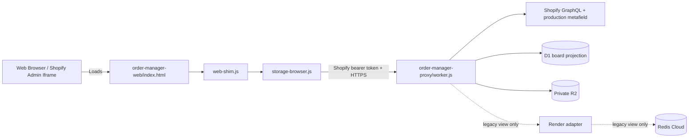

# Web & Shopify Admin Porting Workflow

## Use This When
- You are modifying files under `order-manager-web/` or `order-manager-proxy/`.
- You are updating web-shim handlers, browser local storage fallbacks, or Cloudflare Worker proxies.
- You are optimizing CSS layout for Shopify Admin embedded viewports or mobile devices.

## Skip This When
- You are working on Electron native IPC handlers in `main.js` → read [IPC and storage](../architecture/ipc-and-storage.md).
- You are troubleshooting desktop Electron Builder packages → read [Developer setup and build](../runbooks/dev-setup-and-build.md).

## Section Map
- [1. Web Port Architecture Overview](#1-web-port-architecture-overview)
- [2. IPC Shim & Storage Abstraction](#2-ipc-shim--storage-abstraction)
- [3. Cloudflare Worker Proxy Integration](#3-cloudflare-worker-proxy-integration)
- [4. Viewport & CSS Decoupling](#4-viewport--css-decoupling)
- [Common Failure Modes & Recovery](#common-failure-modes--recovery)

---

## 1. Web Port Architecture Overview

The web port (`order-manager-web/`) enables running the entire PrintMO Kanban workspace directly inside standard web browsers or embedded within the Shopify Admin interface.

---

## 2. IPC Shim & Storage Abstraction

1. `web-shim.js`: Checks if `window.api` is defined. If undefined (running in browser environment), it injects a polyfill exposing `window.api` methods.
2. `storage-browser.js`: Implements the underlying storage and data handling for `web-shim.js`, using browser `localStorage` or making HTTP calls to `order-manager-proxy/worker.js`.

---

## 3. Cloudflare Worker Proxy Integration

- **File**: `order-manager-proxy/worker.js`
- **Deployment**: Deployed as a Cloudflare Worker.
- **Responsibilities**:
  - Enforces allowed origins plus Shopify App Bridge bearer-token signature, shop, audience, expiry, and partner-user validation.
  - Owns Shopify Admin GraphQL access, compare-digest production mutations, D1 projections/app records, webhook deduplication, reconciliation, and stable DTO assembly.
  - Requires authenticated short-lived tickets for private R2 bytes.
  - Sends only validated aggregate garment lines to the stateless S&S gateway.
  - Keeps Render/Redis calls behind explicitly named legacy or migration routes during acceptance.
  - Handled via `scripts/prepare-cloudflare-pages-upload.sh`.

The prepared Cloudflare Pages artifact injects the public Shopify client ID, hashes its asset URLs, and records a release marker in the output HTML. Root `renderer.js` is copied into the artifact only; preparation must never rewrite the tracked `order-manager-web/renderer.js` fallback. Source HTML intentionally contains a placeholder and must not be deployed without `npm run prepare:cloudflare`.

For Pages publishing, `npm run prepare:cloudflare` only creates a local artifact. Use `npm run repo -- deploy cloudflare -- --production` for the live site or `npm run repo -- deploy cloudflare -- --preview <branch>` for a preview. The deployment command verifies the marker from its target before reporting success.

Pages deployments replace the entire web artifact. Before publishing from an isolated checkout, compare its HTML loaders and runtime assets with the current production release and preserve already-shipped features, including uncommitted work from another chat. Starting from Git HEAD alone can silently remove a newer deployed feature; a valid release marker verifies delivery, not feature preservation.

### Source-switched operational board

#### Prepared Orders preparation screen

Copy testing link is a separate action inside Link options and the saved-order menu. It preserves the same prepared-order ID and explicitly adds the current Designer Testing 2 theme parameter. Normal copies remain clean; the testing choice is never persisted on the publication or as the default. Clipboard fallback displays the actual selected URL.

Complete published recipient presentation now opens without Shopify product reads; incomplete legacy data retains bounded deduplicated fallback. Fresh quotes use `prepared-price-products.mjs` to batch snapshot-member variants and current product/configuration metadata, without catalog media or all-color variant pagination. Current print prices are still resolved and checkout validates afresh. Only simultaneous identical quote requests coalesce; no completed-price cache can bypass current pricing or revocation checks.

Sizes & quantities is optional on each garment. Staff may prefill known counts or
leave them for the customer. Counts are bounded whole numbers, saved independently
of Designer project data, and hydrate for both editable and supplied-mockup items.
Replacement garments retain counts for explicit review; new colors/alternatives
start without counts. Unoffered saved sizes must be cleared before applying the
admin quantity form, and remain recoverable in recipient size controls. Publishing
review shows each item's counts. Customers can change prefills without modifying
the staff snapshot.

The public bearer `/size-guides` read resolves only products in the validated,
unexpired published snapshot, with one optional batched Shopify metadata request
and a five-minute cache. Approved current structured measurements take precedence
over the existing size-chart Page reference. Internal source/reviewer metadata is
not published. Denied optional access or missing charts returns no guide and never
blocks recipient boot, quotes or checkout. This does not broaden Shopify scopes or
create new chart data; the recipient sanitizes legacy Page markup before display.

Add/Change garment opens the dedicated finder: desktop keeps results and selected
garment/colors side by side, while mobile has an explicit Back to results path.
Mobile filters are a separate view with staged changes and Show garments; they
never stack their controls above the result list. Search debounces 300ms, Enter
can submit immediately, old responses cannot replace newer searches, and pending
color selections survive browsing/filter changes. Multiple product/color options
are added together through the existing configuration/artwork-preservation path.
Color-only changes still use the existing direct picker. No Studio engine runs
inside either picker.

Status, garment type, brand and color-family facets combine with AND between
facets and OR within each facet. Search covers names, brands, styles and offered
colors; code-like searches also query native Shopify SKU matches. Filters cover
the complete eligible catalog rather than a loaded result page. The compact
catalog index lives in private R2 with request-coalesced memory caching; after
five minutes an authenticated read can serve the snapshot while refreshing in
the background. Refresh catalog explicitly waits for fresh Shopify metadata.
Selected garment details and publish/checkout still validate current Shopify data.
Native base-color taxonomy references take precedence; denied optional metadata
access uses previously cached references, then named/hex family fallbacks.
Unmapped colors remain browsable, missing images never exclude products, and
color-family matching means an offered variant, not an inventory guarantee.

The saved-preparation list opens by default and has Current / Archived / All
views, server-side customer/order/garment search, global recent/name sorting,
25-row pagination, saved thumbnails and per-row customer-link state. R2 summary
metadata drives browsing; older records hydrate their summary on read. Visible
private thumbnails load lazily with three concurrent reads; no editor, mockup
generation or per-row Shopify catalog calls run for this list. Link badges
reflect the locally acknowledged publication and expiry; Copy/Preview validates
the current upstream link before using the canonical website URL. Do not label
a copied link as sent or infer that an order has been purchased.

Archive / Restore are separate private management metadata, so they never change
the design revision or disable a customer link. Rename changes the preparation
title and requires publishing to update customer-facing content. Bulk operations
apply only to explicitly selected listed records and report partial failures.
Deletion requires confirmation, shares the publisher lease, and revokes the link
before writing a deletion tombstone with compare-etag protection. A failed revoke
retains the preparation; a concurrent edit blocks deletion. Tombstones prevent
stale saves from restoring deleted work. This is list/lifecycle removal, not an
asset-retention purge: original assets and immutable published/checkout snapshots
remain available to internal production recovery; deleted preparations and their
admin asset URLs cannot be reopened. Purchased Shopify orders are never deleted.
The browser preserves list search, view and scroll when returning from an order.

Opening a saved preparation shows the local animated robot and a live loading
message until the record resolves. The image has a separate animation-free SVG
selected by `prefers-reduced-motion`; failures clear the loading overlay and
restore the saved-order controls. There is no minimum display delay.

Customer-link publishing now connects the private preparation screen to the
existing Designer Prepared Orders lifecycle. Authenticated publish/update/revoke
actions reuse its expiry, revocation and owned asset URLs; the existing Studio
and ordinary Share Link flows remain unchanged. The generated link opens the
existing website at `/pages/designer-studio?preparedOrder=<id>`, using its
`SharedLinkLandingModal` recipient review. The earlier Pages customer page is
now only a compatibility redirect; do not build a separate recipient UI.
The prepared-order Designer assets are promoted to the live storefront. Generated
and refreshed URLs contain only the preparedOrder ID, with no preview_theme_id.
The old preview environment variable is explicitly empty because keep_vars would
otherwise retain it, and URL construction ignores even a stale preview value.
Both refreshed admin links and old Pages redirects use the normal website URL.
Customers review mockups/configuration, choose sizes and quantities, confirm any
omitted garments and continue to a Shopify draft checkout. No invoice email is
sent. `write_draft_orders` is required and checked before issuing a link.

The website also offers Add to cart when every selected garment and print add-on
is purchasable through the Online Store. Quote responses include `cartHandle` for
garments and print variants so the browser can check exact public availability
and prices. Unlisted status alone is never a reason to suppress cart. Both
purchase actions export the current customer-edited design; cart uses the
existing Designer persistent export uploads and grouping properties, while
draft checkout uses Order Manager's production attachments. Editable previews
rehydrate all designed sides on initial load; manual mockups remain per-item.
The isolated editor adds live drag selection, a touch-sized rotation handle and
horizontal-only centering; Front/Back/Left/Right are views, with print classes
kept separate and legacy chest-view coordinates rebased when reopened.

Prepared garment selection reads Shopify native option-value swatches (solid
colors and image textures), falling back to Designer-configured swatches and
finally a named unknown-swatch choice. Missing swatches never prevent selection.
The public recipient bridge also carries native swatches into workspace colors,
with exact saved-item/Designer swatches as fallback instead of inventing gray.
Previously published alternative definitions recover their saved exact swatches
without querying inactive product availability. Refreshing an existing customer
link picks up the presentation repair; no republish or new link is required.
The current color has a direct picker beside Add another color; color-only
changes retain other non-size options such as fit, and adding colors permits
multiple selections without replacing the original garment. Swatches also
appear on the order's garment list. A color change keeps supplied mockups as
references and marks the garment as needing a new mockup rather than recoloring
a flat customer image.

Artwork reuse and garment/color changes retain source physical calibration.
A single serialized, on-demand preview iframe uses the same isolated placement
editor in `previewOnly` mode, rebases that calibration to the target garment,
classifies the resulting prints and saves a fresh proof without opening the
interactive editor or full Studio. Fit adjustments are flagged for review.
Unlisted/no-image products use a labeled placement reference. Failed previews
offer retry and never discard the editable project. Existing missing proofs can
be refreshed with Generate mockup. Old/stale preview results are rejected by
order, item and project signature. Private artwork blobs are shared within the
open order and released when leaving it; previews are never loaded on board
startup. `prepared-preview-renderer.mjs` reuses that iframe within the open order
but unmounts each completed canvas. It acknowledges each preview response and
checks source, origin and session before accepting it. Calibration and manifest
data stay warm, while raster upload bytes are reused for display rather than
downloaded again (SVG still uses the server-sanitized bytes). Preview capture uses
a cancellable task and synchronous Konva draw, not animation-frame callbacks
that hidden embedded frames may stop receiving. Asset reads, product reads and
saving start together; explicit image/initialization failures return immediately.
Publishing waits for queued previews and the final autosave so it cannot
publish half of an artwork/color update.

The server reloads legitimate Active/Unlisted variants and canonical Designer
print classes, honors saved class overrides, supports explicit manual printing
or no-print configuration, and reads actual Shopify variant prices. Missing
images, mockups or Studio projects do not prevent manual-item purchasing. Private
notes never enter public review; the optional customer message is explicit.
Checkout accepts quantities for prepared variants only, rechecks link lifecycle
and prices, preserves group/batch metadata, and reuses a session/selection-keyed
checkout on retry. Uncertain mutation responses recover by a deterministic tag.
An already-open Shopify checkout survives later link revision or revocation.

Publishing loads each distinct product once per request (up to three concurrently), reuses
those same reads for the recipient template, and copies at most two images at a
time. The private link mapping records acknowledged content-addressed assets
scoped to that specific public link ID. Unchanged files are reused without
reading or uploading their bytes; revoking/expiring a link never permits reuse
of its asset URLs in a replacement link. Failed active-link updates retain
acknowledged copies for retry and preserve the last published customer version.

Normal publishing skips an unchanged saved revision after checking that the
link is still active. The UI labels that state **Link up to date** and keeps
**Refresh products and prices** under Link options. That explicit refresh still
revalidates Shopify data, but skips writing another public revision when content
is identical. Purchase-time price and variant checks remain unchanged.

Staff publishing can request `Accept: application/x-ndjson` to receive actual
checking/products/assets/publishing progress and a final result or typed error.
The stream stays below existing staff authentication; JSON clients retain their
contract. `ctx.waitUntil` tracks publication if the client disconnects. The web
reader treats an interrupted stream as an uncertain result, never a success;
retry checks the same saved link. No polling or artificial percentage is used.

The website receives complete workspace variants/configuration, selected
color, artwork URLs, rotation, dimensions and canvas calibration. The website
uses that server-resolved catalog instead of requiring public product visibility.
Boot must select the saved workspace ID; unconfigured prepared items bypass the
editor-only configuration exit. Supplied mockups are per item, have no editable
project, and cannot enter the editor by button or Escape. Editable items use the
existing edit/return path, retaining quantities and the complete order.

The website requests server quotes after design changes. Checkout validates the
quote, variants and geometry; current artwork is exported through Studio's
calibrated SVG/text exporter and attached to matching draft garment lines.
SVG blob URLs must be expanded to source text before vector export. Shopify
applies eligible discounts at checkout; review does not promise the separate
storefront-cart bulk discount calculation.

Recipient repair released to testing 2026-10-27: Worker
`6da41ac2-13f3-48da-a8b3-3d6f5ca050a7`, Pages `e9320be1` (release
`1793116292601`), Designer Testing 2 entry `designer-entry.CcePrnOM.js`.
The live browser smoke used one unlisted garment with a supplied mockup and one
editable SVG garment. Both reached Shopify checkout with their print charges;
edit/return preserved quantities. No payment was made. The test drafts were
deleted and the temporary links revoked. The published storefront theme has
not been promoted. Full typecheck still reports the existing unrelated missing
`customerNames.js` declaration in the website test tree; builds/contracts and
focused recipient and checkout tests pass.

An immutable private snapshot retains original artwork and placement metadata.
Original PNG/SVG artwork and raster mockups are attached through the established
draft-artwork service before the checkout URL is returned, so its existing paid
conversion preserves line associations. JPEG/WebP source artwork is retained as
a reference rather than mislabeled as a print-ready PNG. Shared files are copied
once per role/location and associated with all selected garment lines. Public
review/checkout are bearer-link operations; creation and administration remain
behind existing staff authentication. The lifecycle token is a Worker secret.
`prepared-commerce-pricing.mjs` is generated from canonical Designer modules by
`node scripts/build-placement-editor.js`; rebuild it before Worker releases.

Customer-link integration released 2026-10-26: Worker
`62b254ed-9127-4979-a82f-2df481e0e72f`, Pages `e5ca3925`, release
`1793072225776`. Production release marker verified. The lifecycle connection
uses the `PREPARED_ORDER_SERVICE` service binding and a server-only staff secret.
The app's additional `write_draft_orders` permission was approved. One live
unlisted garment without imagery reached Shopify checkout with its chest-print
charge; no payment or email was sent, and the test draft was deleted.
Production/grouping attributes use private underscore-prefixed Shopify fields;
the renderer recognizes these for prepared items while preserving Studio fields.
Refreshing a link rechecks Shopify prices and creates a distinct immutable
snapshot when prices change; opening a saved order rechecks lifecycle status.

Workbench and placement correction released 2026-10-26: Worker
`5a5b72d9-f3d4-46b0-bbfe-70f69a3b8fdb`, Pages `d2769552`, release
`1793067454930`. Canonical release and new editor/workbench assets verified.
Isolated desktop/phone checks covered exact sizing, corner resize, undo,
classification override persistence and viewport-contained save controls.

Garment-workflow correction released 2026-10-26: Worker
`f4545a05-24e9-48a4-a728-6c25db166cee`, Pages `c0def5c4`, release
`1793059150923`. Fixes the catalog adapter and introduces the garment-centered
autosaving screen below. Canonical release and updated assets verified; native
Shopify tab testing was unavailable because Computer Use could not verify the
browser URL. Focused service and local DOM workflow checks passed alongside
Phase 1/2 app contracts. Owner interactive acceptance remains pending.

Released 2026-10-26: Worker `c9c23b68-d034-432d-a03c-808273f97784` and production
Pages deployment `784310a3`, release marker `1793057827596`. The canonical live
marker, editor assets and unauthenticated API rejection were verified. Before
release, all 51 existing frontend assets were accounted for and the live Worker
matched the pre-feature Git checkpoint after bundle normalization. Existing
Worker variables were preserved with `--keep-vars`; no migration, scope or app
configuration release was needed. Actual Shopify phone-app paste, keyboard and
interaction acceptance remains owner-tested. This release prepares artwork and
configurations; customer purchase links and checkout were added in the later integration above.

Prepared Orders is a separate destination in the desktop workspace drawer and
phone More area. It opens directly to garment selection and optional mockups;
order names and recipients are optional inline fields; notes use a disclosure. The preparation controller and
placement editor load only when opened. Shopify Admin sign-in and the existing
partner-user authorization gate both the screen's first read and every API.

`prepared-orders.js` is the small navigation loader;
`prepared-orders-workspace.js` and `prepared-orders.css` own the screen.
`web-shim.js` calls `/order-manager/v1/prepared-order-drafts` through the existing
ID-token adapter. The Worker delegates to `prepared-order-drafts.mjs` only after
authentication. Catalog reads include Active and Unlisted products and paginate
all selected product variants. Product images and artwork are optional. These
app preparation records remain private app records. Customer checkout creates a
Shopify Draft Order internally; that commerce handoff is separate from the saved
preparation and does not enroll unpaid work into production.

The garment-centered workspace separates assembly from staff review and link
sharing. Assembly keeps garment/color selection, artwork or supplied mockup
choices, and a visible printing summary together; no-print and manual print
locations remain available without imagery or a Studio project. Manual location
controls reveal classifications only for checked sides and validate unanswered
classes before applying. A persistent Review customer order action opens all
items, customer-facing instructions/message, and existing link actions; publishing
requires printing choices, not images. Order details and internal notes use
compact dialogs rather than expanding above the garment work. Supplied-image
controls stay per-item, with separate order reference images and assignments.
Phone layouts retain the selected garment in a horizontal selector and keep the
review/publish footer inside the available app height. It autosaves through serialized, revision-aware
requests; a lost acknowledgment retries the same mutation before saving newer
edits. Catalog/product calls unwrap the shared GraphQL response envelope and
show recoverable errors. The picker supports pagination, thumbnails and several
colors at once. Garment/color changes and artwork reuse preserve original image
layers but reset calibration and generated proofs for placement review. Supplied
mockups can carry `itemIds` for one or more garments; older images without this
field remain order references. Changing a garment removes its supplied-mockup
assignment instead of presenting the previous garment image as current. Private
records remain backward compatible and require no database migration.

Private R2 stores app preparation JSON and content-addressed artwork under a
shop-scoped prefix. Conditional ETag saves prevent concurrent overwrite and
mutation IDs support uncertain-response retries. Only same-order uploaded asset
IDs are accepted; transient URLs and submitted prices are not persisted. Images
are bounded, privately authenticated attachments; SVG bytes are sanitized by the
shared Designer sanitizer before display. Upload/paste has a native input
fallback, and successful uploads are retained if a later step fails. No new
Shopify scopes, credentials, CORS origins or D1 migration are introduced.

The canonical focused-editor source is in the Website repository at
`designer/src/adminPlacementEditor/`. It shares Studio's Konva stage, geometry,
history, calibration migration, alpha trimming, SVG sanitizer and mockup fallback
loader, with customer telemetry disabled for this admin consumer. It supports
uploaded image layers, drag, proportional width, rotation, centering, locations,
remove and undo/redo. Existing text/full-Studio projects are not imported or
flattened. The editor receives no staff credential: a source/origin/session-
checked parent broker uploads assets and saves the selected item's project and
proof covering every designed side, labeled when multiple sides are present.
Removing the iframe ends its active rendering; leaving the
preparation workspace also releases its image URLs, DOM and product cache. A missing
proof cannot prevent project saving; no-image products use a labeled placement
reference rather than an invented garment composite. Capture waits for each
view's matching mockup and artwork, uses bounded timers even in offscreen frames,
and restores the original editor view. A failed side capture omits the optional
proof rather than saving a misleading partial image. Production artwork remains
separate from this presentation image.

The garment heading exposes **Remove garment** beside **Change garment**.
Removal confirms attached alternatives, cancels obsolete preview work and
removes image assignments while retaining uploaded files as order references.
Automatic print classification must cover every designed side before publishing
or quoting; explicit manual printing and no-print configurations retain their
chosen charges.

The focused editor fits its canvas beside a scrollable settings panel on desktop;
phone editing stacks these inside the inner frame with a persistent save footer.
Exact width/height, proportional slider and a pointer-captured corner handle use
the shared trimmed/rotated ink bounds, safe-area fit and history snapshots.
Print classification reuses Studio's `derivePrintPricingForDesign` and product
tier choices. `printClassOverrides` and derived `printSummary` are optional
private project fields; overrides change classification, not geometry. They are
admin preparation metadata. Purchase conversion validates the chosen class
against current product rules and charges its Shopify print variant.

`npm run prepare:cloudflare` builds a separate hashed editor document from the
canonical source. See `placement-editor-build` in the tool registry for checkout
location and in-memory dependency checks. WSL packaging delegates this build to
Windows Node when using Windows-installed Designer dependencies. Website theme
pushes alone do not publish this Pages artifact. Deploy the Worker and Pages
together for this feature, using the existing verified deployment tooling.

The screen and editor use the inner Shopify iframe height, explicit body scroll
owners, 44px controls and a non-scrolling save footer. The local-only
`shopify-mobile-preview.html` harness includes simulated 112px top and 84px bottom
host chrome around a 393×650 app iframe. Narrow/short iframe checks are required;
this harness is not evidence of authenticated Shopify iOS keyboard, paste or
production acceptance and is excluded from Pages packaging.

The normal header and mobile surface expose only the **Shopify board**. Both adapters remain in the codebase, but Legacy Redis is available only through the explicit `?printmo_debug_legacy=1` operational-debug URL; `web-shim.js` selects the data adapter and mutation endpoints.

Within the Board's **In S&S Cart** section, **Cards / Garments** is a local view choice, separate from the overall Board/List layout. Cards remain the first-visit default and stay mounted when hidden. Garments groups exact supplier SKUs across orders or separates them by order, with visible colors, sizes, quantities, and inline contributions. This is an expected-requirements reference, not a live supplier-cart match. Shelf claims reduce matching quantities; unresolved shelf data and manual/other items retain their needed quantities explicitly. The isolated `cart-garment-model.js` and `cart-garment-view.js/.css` consume the existing board snapshot and read-only shelf endpoint. No supplier, order, or readiness writes occur. Device storage remembers the local layout/grouping, and Legacy remains unchanged. Representative shop acceptance is tracked in the [In Cart garment view plan](../future-plans/in-cart-garment-view-plan.md).

The desktop Orders workspace exposes **Board / List** on normal Shopify app
launches. First visits default to Board; device storage restores the last layout
and sort only. Search, stage, filters, selection and phone expansion reset on
reopen. List uses the same cached orders and
shared detail screen. No special URL is needed. The explicit query parameter
`printmo_list_preview=0` hides the optional layout for rollback/debugging;
older `=1` preview links remain compatible. At viewport widths through 900px,
the Shopify/provider mobile workspace uses list-only Orders, Supplies, Print and
More navigation. It has contextual reviewed actions, inline printed quantities,
session-local search/filter/scroll state and separately stored mobile sorts;
desktop layout preferences are not overwritten. Updates stay in the current
list. Existing purchasing, receiving, planning and full detail remain available.
Acknowledged production saves and conflict reconciliation
merge by provider/order identity into the displayed snapshot immediately; older
queue revisions cannot rewind them. Representative workflow acceptance remains
tracked in the staged list plan.

The desktop candidate dashboard keeps Board/List in the workspace drawer
across both layouts. Draft Orders is a peer destination in that drawer, with its
own scrollable workspace and lazy loading. `workspace-navigation.js` owns active
workspace state, desktop/phone transitions, visibility, focus, and registered
destination lifecycle guards. Draft saves and interrupted edits retain their
existing leave protection. Pipeline retains Filter & sort controls; List never
reparents board tabs or changes its stored layout to show drafts.
The List heading combines Orders, stage filters and Menu in one row; the second
row holds a bounded search field, result count, filters, sorting and receiving.
Column headings remain sticky at approximately 45px including the usable checkbox
target. Selection and detailed save feedback appear only when relevant. Search
uses cached literal matching, is limited to 120 characters and strips control
characters; it never evaluates query text as markup, code or regular expressions.
Draft search also caps the field at 120 characters and preserves the existing
server-side quoted query escaping.
Dashboard navigation uses consistent rectangular/text
controls and restrained blue selection surfaces. In S&S Cart consolidates its
existing buttons into Cart actions, with Mark cart ordered first; Ordered keeps
Receive Batches directly accessible. The contextual popover preserves the
original receiving and production-save handlers and returns Legacy controls to
their original homes. Pale Pipeline footers render garment/print counts in dark
ink. Status colors and source badges retain their existing meanings.

The Shopify shell removes the redundant app toolbar and destination label. Its
right-edge native modal Menu contains the original navigation, Board/List and
Refresh controls, overlays the board, and restores focus on close. Menu occupies
the existing Production header on desktop Board, List heading on desktop List,
and destination headers elsewhere. Phone Menu replaces the existing Sync slot;
Refresh is available inside the drawer. Candidate content fills the iframe with
8px vertical gutters and suppresses App Bridge's bottom pseudo-element spacer so
Sidekick can overlap the independently scrollable queues. Board sections share
title typography and header tracks; desktop Supplies actions occupy its header
instead of a separate Blanks row. The compact garment estimate exposes source
details on demand while keeping incomplete/unavailable states and retry visible.
Source switching restores the original Legacy controls and titles.

Dashboard motion connects tab selections through a persistent travelling underline,
slides the workspace drawer, and provides brief explicit view/disclosure transitions
alongside pointer press feedback and trigger-origin popovers. Keyboard activation
and reduced-motion interactions remain immediate. Animations do not delay handlers,
run during polling, or animate financial values. Production save feedback wraps the
existing serialized update promise and waits for canonical acknowledgment or
conflict reconciliation; mixed failures show review feedback. List workflows
keep their detailed partial/uncertain results and suppress generic save notices.

- Legacy mode retains the existing queue URLs and payloads.
- Shopify mode pages `GET /order-manager/v1/orders`, maps the stable DTO into the existing card contract, and routes drag/drop, notes, readiness, bundle, progress, archive, and batch actions to canonical endpoints.
- Operational customer names use shipping name, then billing name, then customer first/last name. This keeps email-derived customer fields from replacing the fulfillment recipient; `Name unavailable` is reserved for orders where Shopify returns none of those approved fields.
- Manual invoice mockups remain in the dedicated R2 manual-mockup manifest. Shopify board cards hydrate those manifests after the first card paint, and the order detail upload, paste, preview, and removal controls merge manual mockups with Designer Studio assets.
  The Paste button reads supported PNG/JPEG/WebP representations directly when
  browser access permits. If that API is missing or denied, an inline native
  paste field accepts clipboard image files without requiring programmatic
  clipboard permission. Text/HTML is never inserted or interpreted. Empty
  clipboard and upload failures have inline recovery feedback. Clipboard reads
  capture the originating order and discard late results after detail changes;
  uploads remain serialized and respect history/provider upload restrictions.
  This fallback cannot bypass an operating system that supplies no image bytes;
  Upload remains available for Photos/Files in that case.
- **In S&S Cart** and **Ordered** are keyboard-accessible views over the same blanks workflow. They filter on canonical `blanks_cart`/`blanks_ordered` state while keeping both counts visible. A drop into the blanks section persists the currently selected view as the destination stage; selecting a tab alone remains a read-only view change.
- A fully confirmed S&S submission always enters `blanks_cart` (**In S&S Cart**). For a partial supplier result, only orders whose complete garment set was accepted advance; orders with rejected SKUs stay in Build Order. The submission report shows accepted and rejected lines, supplier feedback, and a durable batch reference. The operator-controlled Mark Ordered action is the transition to `blanks_ordered`; later reconciliation preserves that advancement.
- Production & Fulfillment exposes **To Print** and **Printed** tabs in its top-level panel header over the canonical `print` and `completed` stages. The Shopify desktop board has no redundant Ready to Print subsection: `#col-print` is the panel's direct queue scroller, and an explicit view change resets that scroller before the newly selected queue is used. Reaching the nonzero garment total through the board saves `printed_count` and `stage: completed` atomically; lowering a completed count reverses the stage to `print`. Completed but still-unfulfilled orders remain in Printed. Exact Shopify `FULFILLED` removes an order from the active board and exposes it through Previous Orders; clearing a Print-MO archive cannot override that source state, while a Shopify fulfillment reversal restores the preserved production stage when otherwise eligible.
- Print-count validation reads SKU on the first production-state line-item page and every pagination page before applying the non-print garment cap. Order Detail receiving edits use an inline per-garment stepper; the aggregate Receive Batches modal remains available without becoming inert when it opens above Order Detail.
- Receiving-manifest correction is explicit: **Add Orders** shows eligible In S&S Cart and Ordered orders, identifies orders that will move from another batch, and calls the Worker `assign-orders` action. The Worker rejects duplicate create membership and removes an emptied accidental source batch from the active index.
- Shopify moves are optimistic and atomic: the card repaints immediately, one production-metafield mutation persists the complete resulting stage, and a failed save restores the prior card. Per-order requests are serialized; one `VERSION_CONFLICT` is reconciled and retried at most once.
- In normal operation Shopify remains selected even while navigating between app views. In explicit debug mode, a failed source switch restores the previous source and keeps its last rendered board. The Worker also rejects a false authoritative empty candidate until initial migration/reconciliation completes.
- Shopify commerce fields remain read-only. Production fields are changed through `PATCH /order-manager/v1/orders/:gid/production` with expected revision and idempotency key.
- Idempotency fallbacks generate `admin:...`, `board:...`, `detail:...`, or `batch:...` keys from timestamp plus random bytes. Never fall back to `${gid}:...`; Shopify GID slashes violate the Worker contract.
- Full detail comes from `GET /order-manager/v1/orders/:gid`; line-item connections are fully paginated.
- Full detail reattaches every linked private asset to its Shopify line before repainting the Production tab. Design downloads use the stable opaque asset ID to renew an expired one-minute read ticket at click time.
- For Shopify manual-invoice orders, the Production tab can upload SVG, PNG, JPG, or WebP designs directly into Front, Back, or Extras. The Worker stores them through the canonical private R2/D1 asset path and the detail refreshes automatically. Only assets marked as manual uploads expose a Remove action; removal retires the association without hard-deleting the private bytes.
- The order breakdown is presentation-consolidated by item title, SKU, and variant. Quantities and current totals are summed, while Shopify line IDs, batch associations, asset links, and the underlying canonical payload remain unchanged.
- Candidate enrollment accepts paid, unfulfilled, non-cancelled orders. Fulfilled or closed update replays cannot create a new active projection, and a fulfilled default-stage projection is excluded from operational board views; deliberately completed production remains visible in Printed until operator archive. If Shopify later reports `cancelledAt` for an existing projection, webhook or reconciliation refresh marks it inactive without deleting production history, and neither a later production write nor clearing PrintMO archive state can reactivate it while the source cancellation remains.
- Summary line items retain the allowlisted Designer Studio properties. Reconciliation imports matching preview/promoted objects from the `PREVIEWS` binding into checksum-verified private R2 manifests and preserves repeated line-item associations through `asset_manifest_links`. Identical bytes in one order are stored once.
- The candidate read primes one representative mockup ticket per visible order before the initial card render; all other private artwork hydrates after the board becomes usable. This fast path is capped at 1.5 seconds, after which the commerce/production cards render and six concurrent per-asset fallbacks continue independently, so image infrastructure cannot block the board. Cards begin their first paint with every promptly available Designer URL and preview visibility never depends on the 30-second board poll. Manual-mockup manifest completion reconciles only the matching card and never rebuilds a status column over an already-resolved Designer preview. The browser multiplexes and decodes those eager card images directly; no detached-image monitor or timeout serializes otherwise independent previews. The initial queue token is reused only for its immediate ticket batch (at most 30 seconds and never near JWT expiry), with one forced refresh on `401`. One authenticated batch request returns opaque-ID, one-minute signed URLs without JavaScript blob buffering. Ticketed reads are browser-private-cacheable only for the ticket lifetime, so card repainting does not re-download the same private bytes. Mobile primes only the active workflow tab; other previews are deferred until their tab is selected. The complete linked asset set is hydrated only after order detail opens. An unavailable ticket leaves a placeholder without making hidden-stage print files part of the initial mobile load.
- The earlier Shopify diagnostic list/detail endpoints remain available for targeted comparison, but they are no longer the primary candidate surface.
- Protected customer data is shown only when Shopify returns approved fields.
- The Admin order block reads and edits the same metafield. Shopify may host-collapse content over 300px; `collapsedSummary` communicates stage/progress and controls use explicit labels.

#### Current endpoint and data contract

| Endpoint | Shopify operation | Returned data | Cache / boundary |
|---|---|---|---|
| `GET /order-manager/v1/orders` | Bounded stale refresh as needed | Cursor-paged board DTO with Shopify commerce, canonical production state, and one representative private asset | D1 enumeration; maximum 50; no Redis |
| `GET /order-manager/v1/orders/:gid` | Rich order detail and line-item pagination | Shopify facts, production state, attention, and complete linked asset metadata | On demand; no Redis |
| `GET /order-manager/v1/orders/:gid/production` | `PrintMOProductionState` | Canonical stage/revision/readiness/bundle/notes/progress/batch refs | Shopify metafield plus D1 asset manifests |
| `PATCH /order-manager/v1/orders/:gid/production` | `metafieldsSet` with `compareDigest` | Committed production revision or conflict/sync-pending state | D1 idempotency/audit; no Redis |
| `POST /order-manager/v1/orders/:gid/assets` | Order existence read | Uploaded design metadata with role and placement | Authenticated multipart; private R2 checksum readback plus D1 manifest/link; no object key returned |
| `DELETE /order-manager/v1/assets/:assetId?side=...` | None | Remaining safe asset metadata | Manual-upload links only; D1 soft retirement; R2 bytes retained |
| `POST /order-manager/v1/batches/commit` | Production reads during validation/commit | Durable confirmed/partial/rejected/unknown S&S report with accepted and rejected lines plus metadata repair list | D1 state machine; stateless supplier gateway |
| `GET /order-manager/v1/batches/latest` | None | Latest authenticated redacted S&S submission report | D1 batch record; no Redis |
| `GET/POST/PATCH /order-manager/blanks-batches` | None | Private receiving index/manifests, quantity updates, and add/transfer results | Authenticated R2 compatibility store; unique order membership enforced by Worker |

The detail response is grouped under these stable UI-facing properties:

- `data.customer`: Shopify customer name/contact/locale when returned.
- `data.commerce`: display statuses, current subtotal, discount, total, payment gateways, and transaction history.
- `data.delivery`: shipping/billing addresses, checkout shipping lines, fulfillment-order delivery method, and completed fulfillments/tracking.
- `data.conversion`: customer order index, days to conversion, and first/last attributed visit.
- `data.discounts`, `data.lineItems`, and `data.timeline`: normalized order discounts, all line items, and recent Shopify order events.
- `data.note` and `data.tags`: the Shopify order note and Shopify order tags. PrintMO `production.internalNotes` is loaded separately and is never confused with the Shopify order note.

The source adapter is `order-manager-web/web-shim.js`; Shopify-first source control and diagnostic detail are in `shopify-preview.js`; canonical APIs live in `order-manager-proxy/worker.js`; the Admin block is under `order-manager-proxy/extensions/printmo-production-status/`.

**Candidate release (2026-07-24):** Worker `d245b26a-da1a-4d7a-a96b-7737595f2f16`, Pages deployment `7e52d2e2`, Shopify app version `designer-assets-idempotency-2026-07-23`, and supplier gateway commit `420ff72`. The Pages/Worker release adds guest-name projection, atomic optimistic moves with bounded conflict recovery, a selected-view-aware Ordered destination, non-blocking private preview hydration, stable-width candidate card layouts, and mobile detail scroll ownership. The Worker also carries the checksum-guarded one-time position catch-up described in the cutover runbook; it is inert after its completion checkpoint is written. Final acceptance and owner-approved cutover remain separate gates.

**Task 2 release (2026-07-25):** Worker `bbcaa359-2cc9-4115-b612-c58f950c0cf6`, Pages deployment `177d9bb7`, and supplier gateway commit `420ff72`. This release restores manual R2 mockups, persists the independent Blanks Ordered readiness flag, prioritizes fulfillment-recipient names, deploys the previously committed Redis-free S&S route, keeps newly submitted cards in In S&S Cart until the operator marks them Ordered, and restores vertical-only scrolling throughout the embedded mobile order detail. Workflow acceptance remains owner-tested.

**Order-detail recovery release (2026-07-26):** Pages deployment `8aa312c1` restores the shared detail DOM/controller contract, featured mockup selection, accessible tabs, paired ordered-to-ready production states, expanded design-file workspace, inline mutation feedback, and the single-scroll-owner mobile workbench. Worker, Shopify app, supplier gateway, and cutover state are unchanged. Workflow acceptance remains owner-tested.

**Canonical detail workbench release (2026-07-26):** Worker `1552669a-4003-4f2a-8e27-45b8480165e1` and production Pages deployment `a708cc2c` connect the shared Shopify-board detail to the on-demand canonical order endpoint while preserving bounded board first paint and Legacy Redis isolation. The canonical query uses direct Order and LineItem fields rather than customer/product relations; shared detail now renders Shopify timeline and a separate PrintMO production history, conversion, checkout shipping/delivery windows, grouped collapsible tax detail, actual shipping or local-pickup labels, and design-file-linked size metadata. SKU is a separate line-item column and internal asset metadata stays out of the normal item table. Shopify scopes, app version, supplier gateway, and cutover state are unchanged. Workflow acceptance remains owner-tested.

**Dashboard workflow-foundation release (2026-08-06):** Production Pages release `1786040513631` removes the unfinished Bundle and Fullscreen entry points from the web dashboard, flattens the Shopify desktop Production & Fulfillment queue under its top-level To Print/Printed header, resets print scroll on explicit view changes, and gives candidate cards one stable preview/status anatomy with a quiet No preview state. Mobile retains separate Print and Blanks stages, its existing one-column phone/two-column wider-iframe card geometry, and 44px print tabs. Worker, database, authentication, Shopify permissions, Electron/Legacy renderer hooks, and private-preview loading boundaries are unchanged. Automated contract acceptance passed; owner visual acceptance remains manual.

**Production-count and receiving-correction release (2026-08-06):** Worker `989a3f57-1632-4cbe-b810-8f7916693529` and production Pages deployment `f00284c1` (release marker `1786045361453`) restore first-page SKU input to the printed-count garment cap, replace ordinary order-detail receiving modal stacking with inline quantity controls, register dynamic receiving/correction dialogs in the shared focus stack, and add explicit order selection with unique cross-batch transfer. Already-received quantity follows a moved order, and an emptied accidental source batch leaves the active index. No database migration, Shopify scope/app release, authentication, or supplier-gateway change was required. Automated contract acceptance passed; owner workflow acceptance remains manual.

**S&S submission-feedback release (2026-08-21):** Worker `b78339c7-e22d-4d13-b4a8-52e7bfbaa410`, production Pages release marker `1787368100178`, and supplier gateway commit `d3a0d5a` persist, safely forward, and display normalized confirmed, partial, rejected, and unknown supplier outcomes. Rejected rows identify the affected PrintMO order, human-readable garment/variant, supplier SKU, quantities, and operator-safe supplier reason when S&S returns a SKU or indexed line error. Partial batches advance only fully accepted orders, and uncertain results warn against blind retry. `SS_TEST_ORDER=1` remained enabled. The registered local simulator exercises the mapping without external requests or state changes.

**Order Detail Phase 1 reliability release (2026-08-24):** Production Pages deployment `5650b797` (release marker `17876050863N`) isolates note drafts by provider-aware immutable order identity, repaints production controls from canonical revision/progress/readiness state, limits dialog wrapping to rendered tabbables, capability-gates commerce-source customer-name editing, scopes the four readiness flags to materials, adds recoverable notes-save feedback, and closes the bounded mobile/accessibility defects documented by the audit. Worker, database, Shopify scopes/app version, production schema, and supplier gateway are unchanged. Syntax, Phase 1, Phase 2, documentation, artifact, upload, and live-marker verification passed; authenticated keyboard, populated-detail, mobile-geometry, and owner acceptance remain pending.

**Order Detail Overview v1 release (2026-08-24):** Production Pages deployment `ca4ad26c` (release marker `17876084003N`) makes Overview the default Shopify Order Detail workspace and derives a transparent navigation recommendation, workflow snapshot, recorded-attention summary, freshness label, and order facts from existing fields. Mobile material and print recommendations scroll and focus the actual production controls below the Overview. No Worker, database, Shopify scope/app version, production-schema, supplier-gateway, or customer/order-record change was required. Focused syntax, Phase 2, documentation, artifact, upload, and canonical-host release-marker verification passed; authenticated populated-detail visual acceptance remains owner-tested.

**Order Detail print-progress reliability release (2026-08-24):** Production Pages deployment `7a803619` (release marker `17876102743N`) removes the per-request `+1 Print` lock, paints rapid increments immediately, serializes one mutation at a time, and coalesces a burst to the latest desired total. Revision-aware detail hydration cannot rewind newer or pending progress, and the redesigned validated count dialog provides explicit decrement/increment and `Mark all printed` actions. Setting the exact garment total now persists `printed_count` and `completed` atomically; lowering it returns the canonical stage to `print`. No Worker, database, Shopify scope/app version, production-schema, supplier-gateway, or customer/order-record change was required. Focused syntax, executable concurrency/completion/rollback regressions, Phase 2, documentation, responsive dialog inspection, artifact, upload, and canonical-host release-marker verification passed.

**Manual design upload release (2026-08-25):** Worker `c21ae215-b7de-484c-915f-e0ad597509a8` and production Pages deployment `f0c24982` (release marker `1787679222819`) let authenticated operators attach SVG, PNG, JPG, or WebP artwork to a Shopify order as Front, Back, or Extras. Uploads use the existing private R2/D1 manifest path with size validation, SHA-256 readback verification, safe client metadata, placement-aware rendering, and source-gated removal that leaves private bytes recoverable. No D1 migration, Shopify scope/app release, production-metafield change, supplier-gateway change, or Google Drive integration was required. Syntax, proxy tests/build, Phase 1, Phase 2, documentation, Worker dry-run/binding checks, remote migration check, production upload, fail-closed probes, release-marker verification, and live asset-content checks passed.

**Mobile board recovery release (2026-08-25; accepted after environment correction):** Production Pages deployment `590f0abe` (release marker `17876858473N`) restores validated `shop`/`host` embedded context before App Bridge loads, allows the bridge a bounded startup window, and exposes a retryable board error instead of rendering authentication or transport failure as zero orders. Dashboard empty-state logic now runs only after a successful queue response, and the renderer's mobile tab state includes Storage and switches `data-active-view` explicitly. Syntax, Phase 2, documentation, artifact preparation, fixture-card rendering, Storage routing, error recovery at 393px and 320px, production upload, and canonical-host release-marker verification passed. The owner's first native-app check reported that cards still did not work, but a later retest after updating the Shopify mobile app confirmed that the board and cards render. Preserve the historical failed attempt, but treat the outdated app version as its confounder; do not introduce a same-origin authentication relay unless an updated app reproduces an authenticated request failure with direct evidence. Worker, database, Shopify scopes/app version, production metadata, supplier gateway, and existing manual-upload behavior remain unchanged.

**Mobile Order Detail navigation release (2026-08-26):** Production Pages deployment `2d498349` (release marker `17877829113N`) turns mobile Order Detail into a drill-in screen beneath the persistent Orders, Blanks, Print, and Storage command surface. The header exposes a touch-safe **Back** action; Back restores the originating stage and card focus, while selecting a global stage closes Detail before navigating. The covered board remains inert without disabling the mobile command surface, and desktop Detail retains its modal, Escape, and focus-isolation behavior. Focused syntax, Phase 2, documentation, 320px/393px interaction and layout checks, desktop modal regression checks, artifact preparation, production upload, and canonical-host marker verification passed. Worker, database, schema, authentication, Shopify app/scopes, supplier gateway, and order records were unchanged.

**Previous Orders release (2026-09-02):** Worker `d991db45-e13d-40d5-8c3d-6f0e3f335626` and production Pages deployment `56f49cab` (release marker `1788390148290`) remove exact Shopify `FULFILLED` orders from every active dashboard section, including Printed, while preserving D1, production, audit, and private artwork state. Desktop **Previous Orders** and mobile **History** load 25 lightweight fulfilled-only rows on selection, support signed-cursor pagination and server-side order/customer search, and omit asset summaries until a view-only detail is opened. Completed but unfulfilled orders remain in Printed; cancellation and operator archive retain their separate rules; fulfillment reversal restores the preserved stage when otherwise eligible. Syntax, Phase 1, expanded Phase 2, Admin-block verification, documentation, responsive review, Pages artifact preparation, Wrangler dry-run/bindings, remote-migration check, D1 recovery bookmark, Worker/Pages deployment records, canonical marker, unauthenticated API boundary, and read-only aggregate production acceptance passed. No migration, scope change, Etsy behavior, supplier change, or real-order mutation was performed. Owner authenticated UI acceptance remains pending.

**Previous Orders navigation/detail correction (2026-09-03):** Production Pages deployment `868f08f5` (release marker `1788474708519`) makes desktop Previous Orders invoke the same lazy loader used by mobile History and mounts the shared Order Detail overlay at the app-content root instead of beneath the hidden active-orders view. History rows now open that visible shell immediately through the current enhanced detail controller; canonical commerce data and private artwork hydrate inside it on demand. This removes the inert-screen freeze without preloading list artwork or changing the view-only history boundary. Focused syntax, Phase 1/Phase 2 regression coverage, documentation validation, artifact preparation, Cloudflare deployment-record verification, and canonical release-marker verification passed. Worker, D1, Shopify scopes, Etsy behavior, and order records were unchanged.

**Previous Orders manual-mockup correction (2026-09-03):** Production Pages deployment `67c73fcb` (release marker `1788475312134`) separates permission to read existing manual Shopify mockups from permission to upload or remove artwork. Fulfilled history detail now retrieves those private order-number manifests even though the history surface remains view-only; Designer Studio and D1-backed design assets keep their existing on-demand path, and Etsy remains isolated. Focused renderer syntax, executable Phase 1/Phase 2 regression coverage, interface detector, documentation validation, artifact preparation, deployment-record verification, deployed-renderer inspection, and immutable/canonical marker verification passed. Worker, D1, Shopify scopes, Etsy behavior, and order records were unchanged.

#### Shopify access requirements and current limitation

- `read_orders` covers the base order, line items, transactions, fulfillments, conversion summary, discounts, and events for the normal Shopify order-access window.
- `Order.fulfillmentOrders` returns `FulfillmentOrder` objects, which Shopify governs through fulfillment-order scopes. This order-management read requires at least `read_merchant_managed_fulfillment_orders`; include `read_third_party_fulfillment_orders` when the app must see orders assigned to third-party fulfillment services. See Shopify's [FulfillmentOrder access-scope contract](https://shopify.dev/docs/api/admin-graphql/latest/objects/FulfillmentOrder).
- Name, address, phone, and email are separately governed protected customer fields. Request only the fields the operational UI needs through Shopify's [protected customer data process](https://shopify.dev/docs/apps/launch/protected-customer-data).
- `write_orders` is required for the app-owned production metafield.
- `read_all_orders` keeps unfinished production work accessible beyond Shopify's default order window.

The rich-detail scopes plus candidate `write_orders` and `read_all_orders` scopes are approved on the production installation. Canonical Shopify-board/Admin-block writes have been verified; final cutover remains a separate owner decision.

Changing Shopify scopes is a deployment and merchant-approval operation: update `order-manager-proxy/shopify.app.toml`, release a new Shopify app version, and approve the permission update on the production `Print-MO` installation. A Worker or Pages deploy alone does not grant Shopify scopes.

---

## 4. Viewport & CSS Decoupling

The web port must operate within constrained Shopify Admin viewports as well as mobile browser screens:

- `desktop.css`: High-density dashboard styles optimized for widescreen shop monitors.
- `mobile.css`: Responsive mobile and constrained iframe styles enforcing min 44x44px touch targets and full operational capabilities across columns.
- `dashboard-triage-enhancements.js` assigns the candidate-only `pipeline-main-card` and `production-card` contracts used by the final layout rules. A selector for either class is ineffective unless the renderer actually assigns it.
- Shopify-only repair rules are scoped under `body[data-order-source="shopify"]`; candidate acceptance must not change the Legacy Redis presentation.
- `.workflow-card-grid` is the stable queue-layout contract for the relocated Supplies and Production queues. Do not couple future layout rules to `.fulfillment .sub-section`: Shopify desktop reparents Blanks into Supplies and intentionally keeps the print queue flat under Production & Fulfillment.
- Every Shopify order tile owns a stable preview slot and `.production-card-statuses` row. Missing or unavailable artwork replaces the preview content with a quiet **No preview** state instead of removing its geometry; accounting and production badges use the shared status row so card anatomy does not vary by workflow stage.
- The web dashboard intentionally withholds the unfinished Bundle and Fullscreen entry points. The guarded shared renderer hooks and existing-bundle display contract remain compatible with Electron/Legacy surfaces, but those secondary actions must not be restored to Shopify headers without a separate interaction design and regression review.

### Shopify Embedded Mobile Interaction Contract

The mobile web surface is an application viewport inside Shopify Admin, not a
document page. Its outer shell remains fixed to the iframe viewport while the
active queue, detail view, or workflow sheet owns vertical scrolling.

Normal Shopify mobile browsing uses `mobile-order-workspace.js/.css` and
`mobile-order-model.js`, gated by `data-mobile-workspace="true"`. Work-area
navigation is owned by `workspace-navigation.js`. Card-grid and old phone-tab
presentation rules below describe the mounted fallback board used by Legacy or
the explicit `printmo_list_preview=0` rollback URL. Shared scrolling, source
isolation and full-detail contracts continue to apply to both presentations.

- Phone order and production cards are tap targets, not draggable desktop
  tiles. Native card dragging is disabled at the mobile breakpoint so it cannot
  steal taps or vertical swipes on iOS.
- Vertical gestures that start outside an active scroll owner, or reach the top
  or bottom of one, are contained inside the app instead of chaining into the
  surrounding Shopify Admin page.
- Storage Browser is the exception to the fixed workflow-screen pattern: its
  full view is top-anchored and owns vertical scrolling, while horizontal
  scrolling and scroll chaining into Shopify Admin remain disabled.
- The Storage item is part of the mobile tab state machine. Selecting it sets
  `data-active-view="storage"`; selecting any order stage restores
  `data-active-view="orders"`. Do not omit Storage from the renderer's allowed
  mobile tabs or it will silently fall back to Pipeline.
- The History item sets `data-active-view="previous"` and loads fulfilled
  Shopify rows only after selection. Its view is a top-anchored scroll owner
  like Storage, but it does not request list artwork, poll in the background,
  or expose production mutation controls in the reused order detail.
- A failed queue load is not an empty queue. The board owns explicit
  `loading`, `ready`, and `error` states; filters may show their empty result
  only in `ready`. Missing embedded context and delayed App Bridge startup must
  remain visible and retryable rather than collapsing the cards to zero.
- Pipeline cards retain a readable two-column treatment where space permits.
  Production cards use a one-column phone grid and become two columns only at
  wider embedded widths; never combine a multi-column grid with a one-third
  inherited card width.
- The mobile Print stage reuses the top-level Production header as a compact
  **Print** header with full-width, 44px **To Print** and **Printed** tabs. The
  mobile Blanks stage retains its own dedicated header and workflow controls;
  flattening the desktop print section must not merge those mobile stages.
- Mobile Order Detail is a drill-in screen beneath the persistent workflow
  command surface, not a viewport-sealing modal. Its header exposes a 44px
  **Back** action; the normal mobile Orders, Supplies, Print and More navigation
  remains directly usable. Storage and History are destinations within More.
  A global stage selection closes Detail before navigating, while Back restores
  the originating stage, board scroll position, and card focus. Keep the covered
  board inert without making `#mobile-command-surface` inert; mobile Detail uses
  `aria-modal="false"`, while desktop Detail retains modal focus isolation and
  `aria-modal="true"`.
- `#detail-content` is the explicit vertical scroll owner for the mobile detail
  drill-in screen. Its inner detail columns must remain intrinsic-height
  (`flex: 0 0 auto; height: auto; overflow: visible`) so their complete height
  contributes to that scroller. The scroll owner locks gestures to `pan-y`,
  clips horizontal overflow, and suppresses page-shell rubber-banding.
- Regression checks must include working stage-navigation taps, order/bundle
  opening, card `draggable=false`, a fixed root shell, and scroll containment at
  both `320px` and `393px` widths.

---

## Common Failure Modes & Recovery

| Symptom / Trap | Root Cause | Diagnosis & Recovery |
|---|---|---|
| CORS error in browser console when fetching orders | Missing origin headers in Cloudflare Worker proxy | Inspect `order-manager-proxy/worker.js` CORS header headers (`Access-Control-Allow-Origin`). |
| Shopify board fails while Legacy Redis works | Shopify token exchange, permission approval, D1 initialization, GraphQL response, or throttling failure | Keep production work on Legacy Redis. Inspect the structured Worker error and request ID; `BOARD_NOT_INITIALIZED` means migration/bootstrap has not established the candidate and must not be treated as an empty board. |
| Shopify detail again shows `404 - [object Object]` while the order exists | A released/installed scope regressed or another optional GraphQL field is denied; a null order is being mistaken for not found | The 2026-07-22 fulfillment-order gate is resolved in production. If it returns, inspect the structured GraphQL error path, compare released versus installed scopes, and preserve partial data rather than assuming deletion. |
| Shopify detail shows customer fields as not returned | Guest checkout or protected customer data fields are not approved for the app | Confirm the order has customer data in Shopify Admin, then review the app's protected customer data API access request. Do not broaden scopes or expose credentials in the client. |
| Shopify board shows `Name unavailable` for a guest checkout that has a recipient name | Summary projection predates the shipping/billing fallback or the approved address name was not returned | Press **Refresh Shopify** once. The forced refresh bypasses the short TTL and projects shipping → billing name without reading Redis. |
| Ordered tab cannot be selected or both tabs show the same cards | The control was styled as a tab but no `setActiveBlanksView`/filtered render contract was installed | Verify `blanks-batches.js` wires click/arrow-key activation and filters `blanks` cards by `blanksOrdered`; do not implement the tabs as status mutations. |
| A Shopify card move pauses, reports 409, then appears only after refresh | Status and readiness were split across requests, or concurrent clients advanced the revision | Use `updateBoardMove` for one stage patch. Keep optimistic repaint/rollback, per-order serialization, and the single conflict reconciliation retry. |
| Mobile detail opens but cannot scroll | The inner detail column retained `flex:1; overflow:hidden`, so `#detail-content` had no measurable overflow even though content was clipped | Keep `#detail-content` as the vertical-only scroll owner and reset its inner columns to intrinsic height with visible internal overflow. |
| Mobile detail opens but the operator cannot return to the board or use another workflow stage | Detail was positioned across the whole app viewport and the modal isolation walk made the mobile command surface inert | Keep Detail absolutely contained by `.app-content`, leave `#mobile-command-surface` above and interactive, close through the canonical Back control before global navigation, and keep only the covered board inert. Verify Back plus Orders, Blanks, Print, Storage, and History at both 320px and 393px. |
| Unsaved inline notes from one order appear when another order opens | The shared detail editor remained in editing state across `closeDetail()`, so `syncNotesContext()` intentionally preserved the stale draft after `currentDetailOrder` changed | Treat note drafts as immutable-order-scoped state. Close/backdrop/Escape must use one cancel/preserve/confirm path, and edit A → close → open B → save requires behavioral regression coverage. |
| Detail opens with readiness/progress controls older than the rich response | `mergeCanonicalDetail()` repainted commerce/assets/stage but did not adopt canonical revision, printed count, and every readiness flag into the local order object used by controls | Merge the complete canonical production control state before repaint and retain expected revision for the next mutation. Test a stale board summary followed by a newer detail response. |
| Shopify customer-name edit opens and then fails | The shared legacy entry point remained visible even though `web-shim.js → window.api.updateName` rejects commerce-source name writes | Capability-gate the action. Shopify names remain read-only; hide or disable Edit name with source-aware explanation. |
| Tab focus wrap stalls, escapes, or lands on invisible controls | The dialog focusable filter counted controls under hidden tab panels, zero-geometry descendants, or negative-tabindex roving tabs | Exclude hidden/inert ancestry, zero geometry, and `tabindex=-1` from the trap's rendered focusable set; verify wraparound with each panel active. |
| Data changes not saved in browser | `storage-browser.js` falling back to read-only state | Check browser local storage permissions and network logs. |
| Layout broken inside Shopify Admin iframe | Mobile CSS media query override missing | Verify `mobile.css` breakpoint rules and container width limits. |

#### Prepared garment alternatives

The private preparation screen offers Add alternative on proposed garments, reusing the existing finder, artwork placement/copy and supplied-mockup upload paths. Items optionally carry `alternativeForItemId`; the server rejects dangling, cyclic and nested groups. Removing a proposed garment explicitly includes its alternatives, retaining uploaded assets.

Publishing retains all configurations in an immutable private snapshot, while the public template contains only proposed garments. Optional choice metadata supplies alternative workspaces to the updated recipient. Quote and checkout selections validate group membership, replacements and explicit extras against that snapshot. Unchosen alternatives cannot enter production lines, assets, omission checks or selected-only quotes. No new public catalog access or staff permissions are introduced.

The updated storefront layout is first deployed to Designer Testing 2. Copied customer links remain clean live-domain URLs; use a separate theme preview URL for acceptance until storefront promotion. Do not send alternative-bearing test orders as customer-ready proposals before that acceptance.
